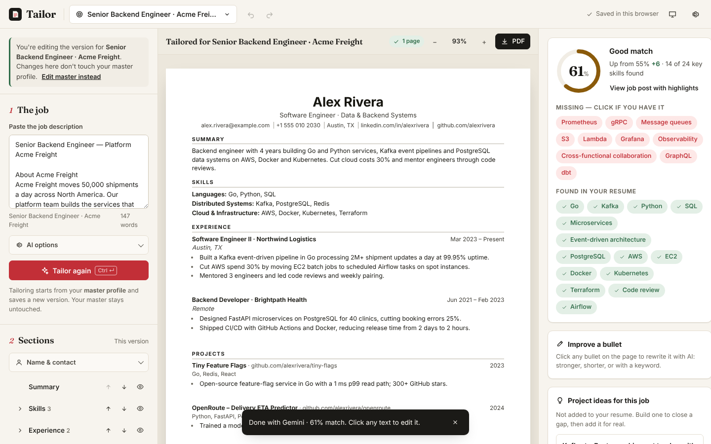

# Tailor — one resume, tailored to every job

Paste a job post and get a version of your resume that speaks its language: honest AI rewrites, a live match score,
and a clean one-page PDF that applicant tracking systems (ATS) can read.



## What it does

- **Studio layout**: build on the left, the real page in the middle, match score and AI tools on the right.
  On tablets the right panel becomes a tab; on phones there is a bottom tab bar.
- **Master profile + versions**: you keep one master profile with everything you've done. Each job gets its own
  tailored version; the master is never changed by tailoring.
- **Honest by design**: the AI may rephrase and reorder, but never invent jobs, dates, numbers or projects.
  A **truth check** removes any skill the AI adds that your master profile doesn't mention.
  The old "invent a project for this job" slot is now **Project ideas**: suggestions you could build, shown on the side.
- **Instant match score** (runs in the browser, no AI needed): required vs nice-to-have keywords, found and missing,
  and the job post with highlights. Click a missing skill to add it, but only if you really have it.
- **Click-to-edit page** with undo/redo, Enter for a new bullet, AI rewrite of any bullet (stronger, shorter,
  add a keyword, fix grammar).
- **Page meter** ("1 page ✓" / "over by 3 lines") and **Fit to 1 page**. 3 ATS-safe templates, A4/Letter, spacing and
  heading color.
- **Import** a PDF, Word file or pasted text; AI splits it into sections (with a non-AI parser as backup).
- **Accounts are optional**: guests save in the browser; signing in (Google or email link) saves to the cloud.
  The first sign-in moves the guest resume into the account.
- **Accessible**: keyboard everywhere, visible focus, screen-reader labels, WCAG AA contrast, reduced motion, dark mode.

## It always works, even when Gemini is down

```
Gemini (several models)  ──error/stall──▶  Groq (backup AI)  ──error──▶  Offline engine (in the browser)
```

- **Slow is not a failure.** Answers stream in live, and a provider is dropped only when it errors, returns bad JSON,
  or sends **nothing at all** for 90 s. A busy model can keep working for up to ~4 minutes (Vercel allows 5).
- **"Use quick version now"** skips the wait at any time.
- The **offline engine** reorders your skills, bullets and projects for the job and trims to length. It never writes new
  text, so it can't make anything up. It also kicks in automatically when the server can't be reached or the daily limit
  is reached.
- Usage limits fail **open**: if the database is down, people can still use the AI.

## Architecture

| Part | Tech | Where |
| --- | --- | --- |
| Web app | React 19 + TypeScript + Vite, plain CSS design tokens | `web/` → Vercel CDN |
| API | FastAPI (stateless), streaming Server-Sent Events | `backend/`, entry `api/index.py` → Vercel Python function |
| AI | Gemini (`google-genai`) → Groq (OpenAI-compatible HTTP) | `backend/ai/` |
| Accounts & data | Supabase Auth + Postgres with Row Level Security | `supabase/migrations/` |

API endpoints: `POST /api/tailor` (stream), `POST /api/parse` (stream), `POST /api/rewrite`, `GET /api/config`,
`GET /api/health`, docs at `/api/docs`.

The browser talks to Supabase directly for the user's own data (RLS ensures people only see their own rows).
The API only verifies who is calling (for daily limits) and runs AI. Name, email and phone are never sent to the AI.

## Run it locally

```bash
# API
python -m venv .venv && source .venv/bin/activate   # Windows: .venv\Scripts\activate
pip install -r requirements-dev.txt
cp .env.example .env        # add GEMINI_API_KEY / GROQ_API_KEY (optional: works without them)
uvicorn backend.app:app --reload --port 8000

# Web (second terminal)
cd web
npm install
npm run dev                 # http://localhost:5173 (proxies /api to :8000)
```

Without Supabase settings, everyone is a guest (saved in the browser). Without AI keys, the offline engine is used.

## Tests

```bash
pytest -q                               # API: fallback chain, stall handling, limits, endpoints
ruff check backend api tests
cd web && npm test && npm run typecheck # match engine, truth check, offline engine, import, undo
```

CI runs all of these on every push (`.github/workflows/ci.yml`).

## Deploy

Everything runs on **Vercel** (free Hobby plan) + **Supabase** (free plan). See [`DEPLOY_PROMPT.md`](DEPLOY_PROMPT.md)
for a step-by-step guide, written so a local Claude session can do it for you.

Environment variables are listed in [`.env.example`](.env.example).

## Your old resume

The original `master_resume.json` is in `examples/legacy_master_resume.json`. Import it from
**Settings → Import resume** (or the welcome screen) and it is converted to the new format automatically.
